<div align="center">

# `aevo.` — Premium Computing, Refined.

**Full-Stack Computing & PC Hardware E-Commerce Platform · Microservices · AI Commerce · Elasticsearch**

[-000000?style=for-the-badge&logo=next.js&logoColor=white)](https://nextjs.org/)
[-171717?style=for-the-badge&logo=express&logoColor=white)](https://expressjs.com/)
[-336791?style=for-the-badge&logo=postgresql&logoColor=white)](https://www.postgresql.org/)
[-DC382D?style=for-the-badge&logo=redis&logoColor=white)](https://redis.io/)
[](https://www.elastic.co/)
[](./docker-compose.yml)
[](./.github/workflows/ci-cd.yml)

<p align="center">
  <em>"Exceptional hardware. Effortless experience."</em><br/>
  Built with 100% pure JavaScript (ES2023), stateless horizontal scaling, real-time WebSocket updates, bilingual support (EN/VI), and dark/light editorial aesthetics.
</p>

[**Explore Demo Gallery**](#visual-demo--ui-walkthrough) · [**Quick Start (Docker)**](#quick-start--deployment) · [**Bonus Features (+2.0/2.0)**](#bonus-features-implemented-20--20-points) · [**Documentation**](#documentation-index)

</div>

---

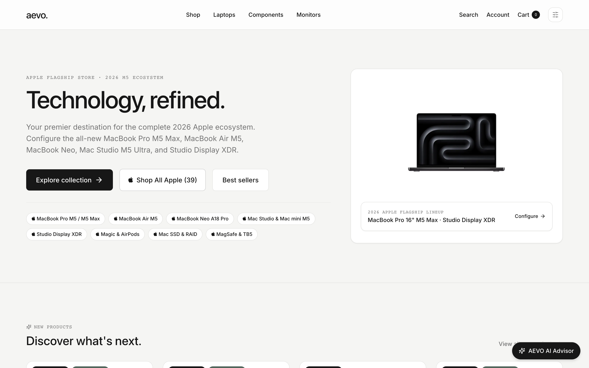

---

## Table of Contents

1. [Overview & Brand Philosophy](#overview--brand-philosophy)
2. [Visual Demo & UI Walkthrough](#visual-demo--ui-walkthrough)
3. [Complete Feature Matrix](#complete-feature-matrix)
4. [Bonus Features (`+2.0 / 2.0 Points`)](#bonus-features-implemented-20--20-points)
5. [Tech Stack](#tech-stack)
6. [Monorepo Structure](#monorepo-structure)
7. [Quick Start & Deployment](#quick-start--deployment)
8. [Default Credentials & Discount Codes](#default-credentials--discount-codes)
9. [Docker Services & Port Matrix](#docker-services--port-matrix)
10. [API Reference Overview](#api-reference-overview)
11. [Automated E2E Verification & Testing](#automated-e2e-verification--testing)
12. [Documentation Index](#documentation-index)

---

## Overview & Brand Philosophy

**AEVO** (`aevo.`) is a production-grade e-commerce ecosystem exclusively dedicated to **computers, workstations, displays, and PC hardware components**. Moving away from cluttered, neon-heavy gaming storefronts, AEVO adopts a **Premium Minimal Editorial Design System** inspired by high-end industrial hardware studios:

- **Curated Computing Catalog**: **187 computer & PC hardware products** across **6 specialized categories** (*Laptops, Components, Monitors, Storage, Peripherals, Accessories*). Every product features **at least 2 independent SKU variants**, **at least 3 studio gallery images**, and **at least 5 lines of technical specifications**.
- **Dual-Interface Experience**:
  - **`AEVO Store` (`/`)**: High-contrast editorial storefront with instant search, multi-criteria filtering, real-time cart synchronization, 5-step guest/member checkout, bilingual (`ENG` / `VIE`) localization, and seamless **Light / Dark Mode**.
  - **`AEVO Control` (`/admin`)**: Executive administration suite featuring real-time KPI telemetry, comparative timeframe analytics (`Year`, `Quarter`, `Month`, `Week`, `Custom Range`), inventory variant management, order lifecycle control, and discount governance.
- **Enterprise Engineering**: Engineered as a **100% stateless API tier** with **8 Dockerized services**, **Redis Pub/Sub asynchronous microservices event bus**, **Socket.IO cross-instance real-time rooms**, **BM25 Elasticsearch engine**, and **AI-assisted shopping workflows**.

---

## Visual Demo & UI Walkthrough

### 1. Editorial Storefront — Adaptive Light & Dark Mode
AEVO's design system pairs warm porcelain surfaces (`#F5F5F3`) with deep obsidian ink (`#171717`) in Light Mode, and transitions effortlessly into a true-black OLED-friendly Dark Mode without layout shift or FOUC.

| **AEVO Light Mode (`Porcelain & Ink`)** | **AEVO Dark Mode (`Obsidian Studio`)** |
| :---: | :---: |
|  | 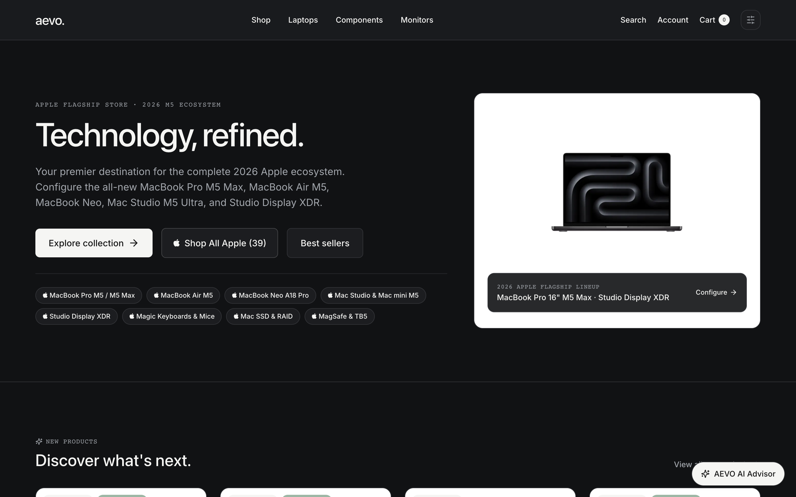 |

---

### 2. Hardware Catalog, Multi-Facet Filtering & AI Visual Search
Customers can browse all 187 computing products with combined keyword search, category pills, multi-brand selection, price range sliders, star rating filters, 6 sort modes, Grid/List view switching, and **AI Visual Hardware Search** by uploading any product photo.

| **Multi-Criteria Catalog & Ecosystem Filters** | **AI Visual Search by Image Upload** |
| :---: | :---: |
| 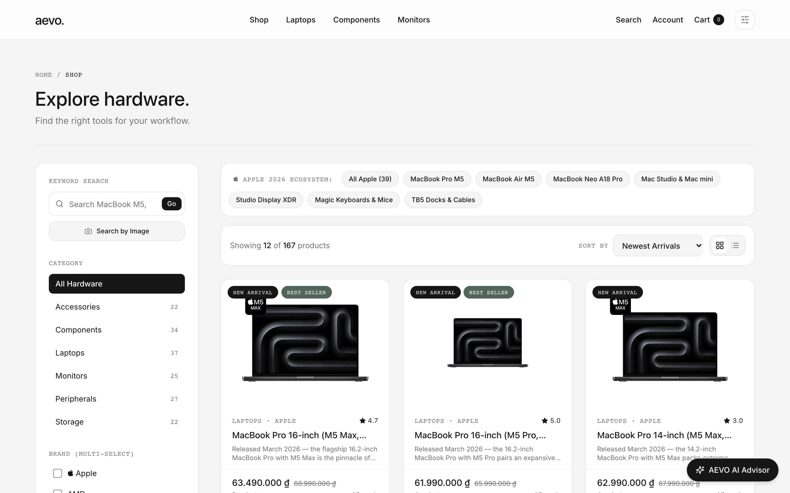 | 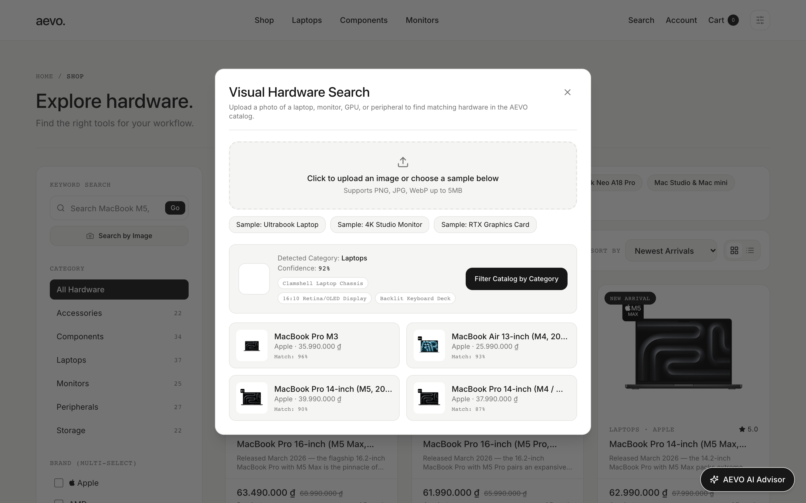 |

---

### 3. AEVO Intelligence v2 — Multi-Turn Agentic AI Concierge & Configurator
The floating **AEVO Intelligence v2** assistant (`AiAssistantWidget` + `POST /api/ai/chat`) delivers an executive Big-Tech AI shopping experience (inspired by Apple Specialist, Amazon Rufus & Perplexity) in both **English and Vietnamese**:
- **Multi-Turn Memory & Page Context Awareness**: Retains conversation history across turns (`sessionStorage`) and detects when a user is viewing a specific product page (`/products/[slug]`) to offer 1-click deep spec & variant analysis.
- **6 Specialized Agentic Capabilities**:
  1. **Precision Hardware & Variant Consultation**: Parses budget ranges (*"dưới 45 triệu"*, *"từ 25 đến 40 triệu"*), workflows (*Coding/AI, 3D/8K Creation, 240Hz Gaming, Executive Mobility*), and matches the exact in-stock `ProductVariant` SKU, discount percentage, and technical highlights.
  2. **Head-to-Head Spec Comparison Matrix**: Generates structured Markdown comparison tables (`| Spec | Model A | Model B |`) with side-by-side pricing, featured variants, ratings, and a specialist buying verdict.
  3. **Multi-Category Workspace Setup Builder**: Allocates target budgets across *Laptops/Workstations + Studio Monitors + Peripherals*, calculating total bundle cost and **10% Loyalty Points** earned.
  4. **Live Discount Codes & Loyalty Balance Lookup**: Queries PostgreSQL in real time to list active 5-character promo codes (`remaining uses / maxUses`) and the signed-in user's redeemable Loyalty Points balance.
  5. **Real-Time Order Tracking**: Looks up live order fulfillment status, itemized hardware, and status history directly in chat by order code (e.g., `AEVO-10001`) or user session.
  6. **Store Policy Concierge**: Answers warranty (24-month official), insured shipping (free over 20M ₫), and payment (COD, VietQR, Visa/Mastercard/JCB, MoMo) inquiries.
- **Interactive Chat UI**: Features a custom Rich Markdown & Table renderer, Expand/Compact view toggle, 1-click Copy, and **Quick Add to Cart (`+ Giỏ` / `+ Add`)** directly inside recommended product cards.

| **Bilingual AI Hardware Advisor Chatbot** | **Product Detail & Multi-Variant Configurator** |
| :---: | :---: |
| 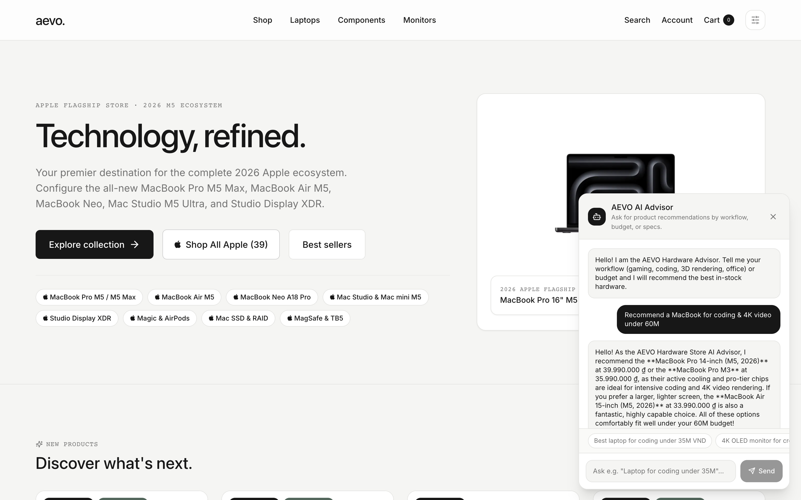 | 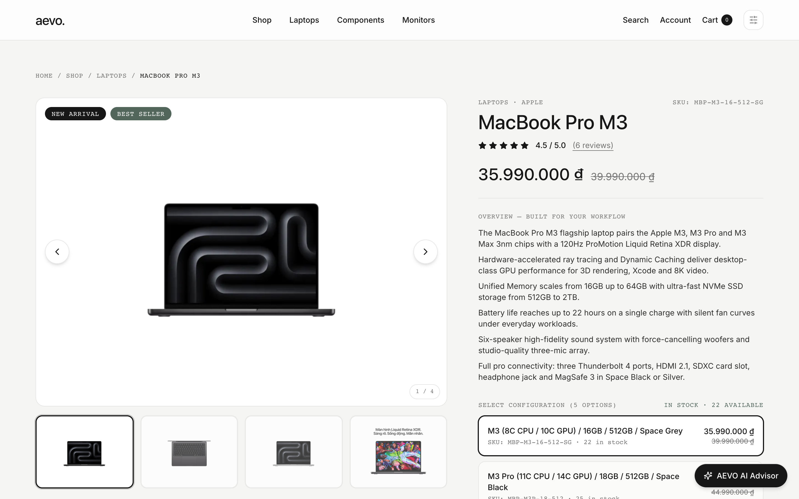 |

---

### 4. Real-Time WebSocket Reviews, AI Sentiment Analysis & Cart
Product reviews broadcast live across all connected browsers via **Socket.IO** without page reloads, enriched with **AI Review Sentiment Analysis** (Positive / Neutral / Negative breakdown & hardware aspect extraction). The shopping cart recalculates tax, shipping, loyalty points, and discounts in real time.

| **Live WebSocket Reviews & AI Sentiment Summary** | **Real-Time Cart & Order Summary** |
| :---: | :---: |
| 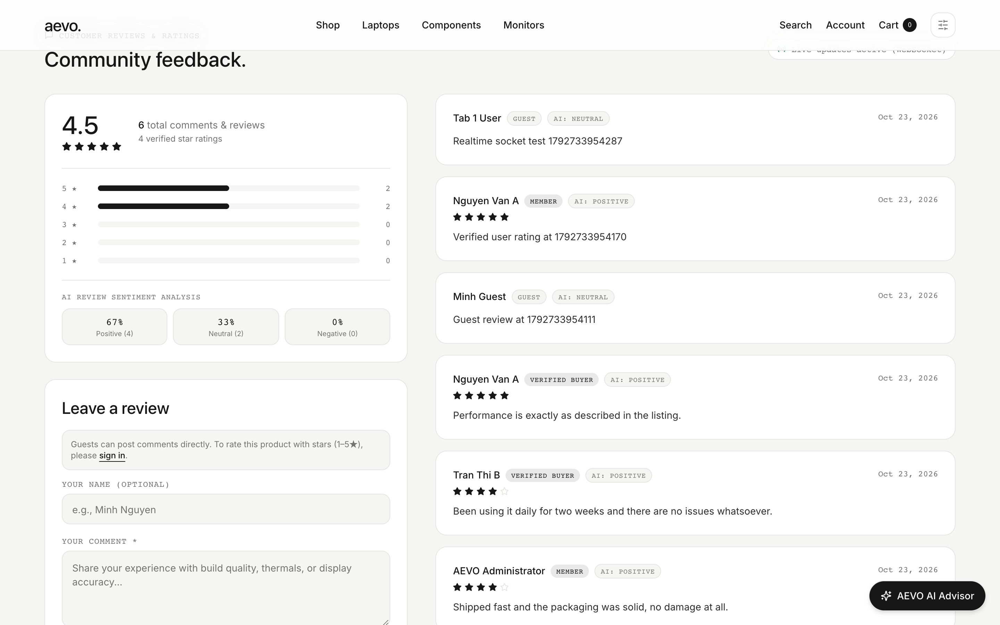 | 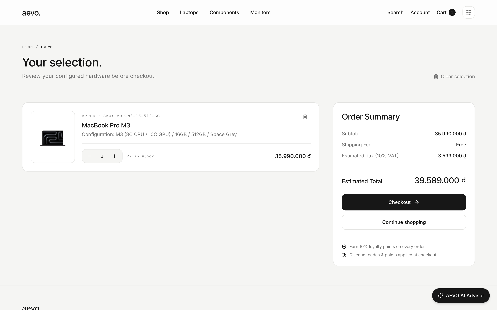 |

---

### 5. `AEVO Control` — Executive Admin Dashboard & Inventory Governance
The single-administrator control center (`admin@aevo.com`) delivers both a **Simple Overview Dashboard** and an **Advanced Comparative Timeframe Analytics Suite** (formatted in VND with 20% gross margin profit modeling), alongside full CRUD for products, variants, categories, orders, users, and discount codes.

| **Admin Simple Dashboard & KPI Telemetry** | **Advanced Analytics & Timeframe Breakdown (VND)** |
| :---: | :---: |
| 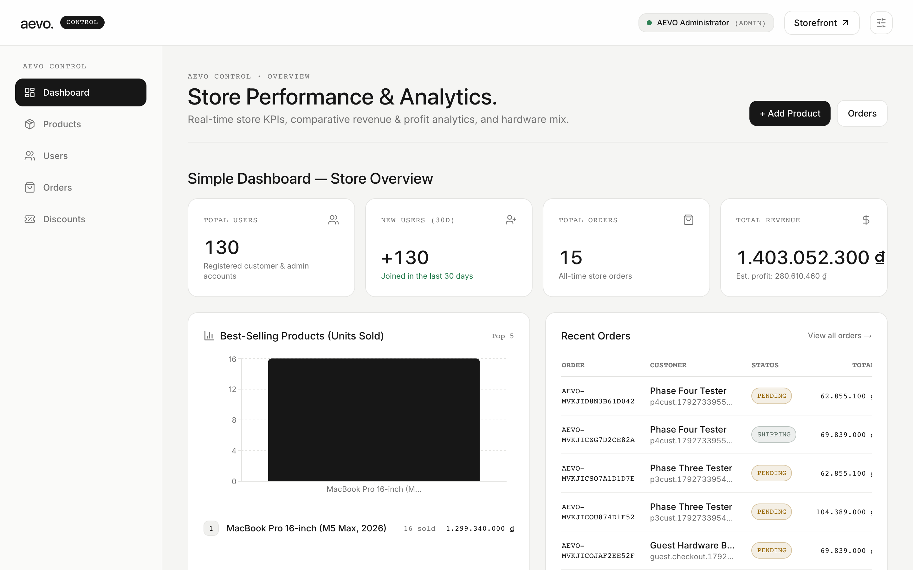 | 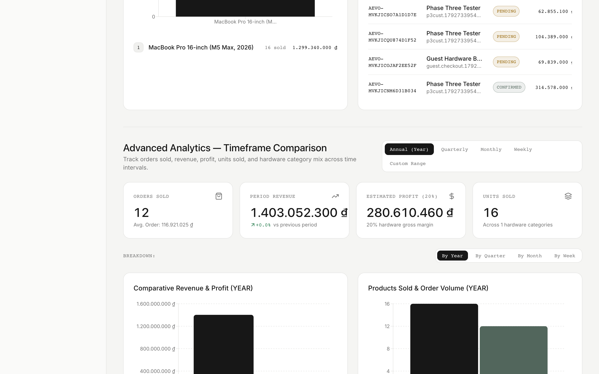 |

<div align="center">

#### **Admin Multi-Variant Product & Inventory Management**
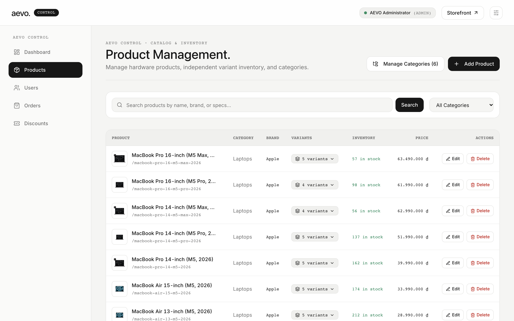

</div>

---

## Complete Feature Matrix

### Customer Storefront (`AEVO Store`)
- **Curated Landing Page**:
  - Dedicated sections for **New Arrivals**, **Best Sellers**, and **6 Hardware Categories** (*Laptops, Components, Monitors, Storage, Peripherals, Accessories*).
  - Interactive pagination across product sections without full-page reloads.
- **Advanced Product Catalog (`/products`)**:
  - Multi-criteria filtering by **Keyword**, **Category**, **Brand (multi-select)**, **Min/Max Price**, **Customer Rating**, and **Product Tags**.
  - **6 Sorting Modes**: Name (`A–Z`, `Z–A`), Price (`Low to High`, `High to Low`), `Newest Arrivals`, and `Best Sellers`.
  - **Always-Visible Pagination**: Displays full page navigation controls and item range indicators even on single-page result sets.
- **Product Detail & Real-Time Reviews (`/products/[slug]`)**:
  - High-resolution multi-image gallery (at least 3 images), comprehensive technical description (at least 5 lines), and interactive variant selector (at least 2 variants) with independent SKU pricing and stock counts.
  - **Hybrid Review System**: Guests can post comments without logging in; authenticated members can submit star ratings (1 to 5 stars) with or without written comments. Updates stream live via **Socket.IO**.
- **Real-Time Cart & 5-Step Checkout (`/cart`, `/checkout`)**:
  - Instant quantity stepping, variant removal, and live subtotal/tax/shipping calculation.
  - **Seamless Guest Checkout**: Automatically provisions a customer account using the guest's email and shipping address, generates a temporary password (`AevoXXXXXX`) + password setup link on `/checkout/success`, and links the order to their new account.
  - **Discount Codes**: Supports 5-character alphanumeric codes with a strict maximum of 10 redemptions and live order total deduction.
  - **Loyalty Points Program**: Customers earn **10% of every order's final total (`totalAmount`)** in loyalty points (`1 point = 1,000 VND`) and can redeem accumulated points directly at checkout.
- **Customer Account & Order Lifecycle (`/account/*`)**:
  - Registration requires only **Full Name, Email, and Shipping Address** (automatically saved as the default checkout address).
  - Social login integration (**Google** & **Facebook** OAuth 2.0), profile management, password recovery/change, multi-address book, loyalty ledger history, and reverse-chronological **Order Status History**.

### Admin Control Panel (`AEVO Control`)
- **Single-Admin Security Boundary**: Enforces a single pre-seeded administrator (`admin@aevo.com`) and blocks privilege escalation of secondary accounts at both the UI and API levels.
- **Simple & Advanced Dashboards (`/admin`)**:
  - **Simple Dashboard**: Total users, new users (30d), total orders, total revenue, estimated profit, and Top 5 best-selling hardware products.
  - **Advanced Timeframe Analytics**: Interactive Recharts visualizations comparing Orders, Revenue, Profit (20% margin), Units Sold, and Category Mix across **Annual (`YEAR` default)**, **Quarterly**, **Monthly**, **Weekly**, and **Custom Date Ranges**.
- **Catalog, Order, User & Discount Governance**:
  - Full CRUD for products, variants, categories, and tags (enforcing at least 2 variants and at least 3 images per product).
  - Order management (`PENDING` -> `CONFIRMED` -> `SHIPPING` -> `DELIVERED` / `CANCELLED`) with automatic inventory restoration and discount usage rollback upon cancellation.
  - Discount code creator and usage inspector showing every order that redeemed a given code.

---

## Bonus Features Implemented (`+2.0 / 2.0 Points`)

Full technical documentation and verification proofs are available in [`Bonus/README.md`](./Bonus/README.md).

| # | Bonus Feature | Score | Key Implementation Details |
| :-: | :--- | :-: | :--- |
| **1** | **CI/CD Pipeline (GitHub Actions)** | **`+0.5`** | Multi-stage workflow ([`.github/workflows/ci-cd.yml`](./.github/workflows/ci-cd.yml)):<br/>• **Stage 1 (`lint-and-validate`)**: Enforces 100% pure JavaScript rule (`0` `.ts/.tsx` files), validates Prisma schema & all 3 Docker Compose configs.<br/>• **Stage 2 (`test-and-verify`)**: Spins up `postgres:16` & `redis:7` service containers, seeds catalog, builds Next.js production bundle, and runs automated E2E suites.<br/>• **Stage 3 (`docker-build`)**: Verifies production multi-stage Docker builds (`Dockerfile.api`, `Dockerfile.web`).<br/>• **Stage 4 (`deploy`)**: Automated production rollout upon merge to `main`. |
| **2** | **Microservices & Async Redis Messaging** | **`+0.5`** | Deploys **8 containers** (`web`, `api` Gateway `:3001`, `product-service` `:3002`, `order-service` `:3003`, `user-service` `:3004`, `elasticsearch` `:9200`, `redis` `:6379`, `db` `:5434`). Services communicate asynchronously via Redis Pub/Sub (`aevo:events:bus`) with live telemetry at `GET /api/microservices/status` and `GET /api/microservices/events/history`. |
| **3** | **AI-Powered Commerce Suite (`AEVO Intelligence v2`)** | **`+0.5`** | • **Multi-Turn Agentic AI Chatbot** (`POST /api/ai/chat` + `AiAssistantWidget`): Bilingual (EN/VI) concierge with conversation memory, page-context awareness, variant-level SKU matching, Markdown **Spec Comparison Tables**, **Multi-Category Setup Builder**, live **Discount/Loyalty lookup**, **Order Tracking (`AEVO-XXXXX`)**, and in-chat **Quick Add to Cart**.<br/>• **Visual Hardware Search by Image** (`POST /api/ai/image-search` + modal on `/products`): Analyzes uploaded PNG/JPG/WebP hardware images and returns ranked visual matches.<br/>• **Review Sentiment & Aspect Analysis** (`POST /api/ai/sentiment` + live badges on `/products/[slug]`): Bilingual sentiment scoring with negation handling and hardware aspect extraction (*thermals, performance, display, build, battery*). |
| **4** | **Elasticsearch Search Engine** | **`+0.5`** | Dedicated search node (`:9200`) with inverted-index **BM25 multi-field ranking** (`name^4`, `brand^3.5`, `tags^2.5`, `category^2`, `description^1`), **Levenshtein fuzzy typo tolerance** (e.g., `"macbok"` -> `"MacBook"`), sub-millisecond edge-ngram autocomplete (`GET /api/search/suggest`), and live **Elasticsearch vs. PostgreSQL `ILIKE` benchmark** (`GET /api/search/benchmark`). |

---

## Tech Stack

| Layer | Technologies Used |
| :--- | :--- |
| **Frontend (`apps/web`)** | Next.js 14.2 (App Router, Pure JavaScript), React 18.3, Tailwind CSS 3.4, Radix UI / shadcn/ui, Lucide Icons, Recharts, Socket.IO Client, Axios |
| **Backend & Services (`apps/api`)** | Node.js 20, Express.js 4.19 (Pure JavaScript), Socket.IO 4.7, Prisma ORM 5.13, Passport.js (Google & Facebook OAuth 2.0), JSON Web Tokens (`jsonwebtoken`), `bcryptjs`, `express-validator`, `helmet`, `nodemailer` |
| **Database & Caching** | PostgreSQL 16 (`postgres:16-alpine`), Redis 7 (`redis:7-alpine` via `ioredis` for sessions, rate limiting, Socket.IO adapter & microservice Pub/Sub) |
| **Search & AI Engine** | Dedicated Elasticsearch Node (`:9200` BM25 + Fuzzy Levenshtein + Aggregations), Google Gemini / Bilingual Hardware AI Engine |
| **DevOps, Scaling & QA** | Docker & Docker Compose (Standard, Microservices & Nginx Horizontal Scaling configs), GitHub Actions CI/CD, Playwright End-to-End Browser Testing |

---

## Monorepo Structure

```text
aevo/
├── .github/
│   └── workflows/
│       └── ci-cd.yml                  # 4-stage GitHub Actions CI/CD pipeline
├── apps/
│   ├── api/                           # Express.js API Gateway & Microservice Runner
│   │   ├── prisma/
│   │   │   ├── schema.prisma          # PostgreSQL relational schema (15 models)
│   │   │   ├── seed.js                # Idempotent database seeder (187 products)
│   │   │   ├── apple-2026.json        # Curated Apple M3/M4/M5 hardware catalog
│   │   │   └── products-2026.json     # PC components, GPUs, monitors & peripherals
│   │   ├── src/
│   │   │   ├── config/                # Database, Passport OAuth & environment config
│   │   │   ├── microservices/         # Standalone microservice runner (:3002/:3003/:3004/:9200)
│   │   │   ├── middleware/            # Stateless JWT auth, RBAC, rate-limit & validation
│   │   │   ├── modules/               # Domain modules (auth, products, orders, cart, ai, search, admin...)
│   │   │   ├── utils/                 # Redis client, EventBus, Elasticsearch BM25, Sentiment, Mailer
│   │   │   └── server.js              # Main API Gateway & Socket.IO entrypoint (:3001)
│   │   └── test/                      # Automated E2E & Playwright verification suites (Phase 1–6, UX/UI)
│   └── web/                           # Next.js 14 Storefront & Admin Control Panel (:3000)
│       ├── app/                       # App Router pages ((storefront), admin, auth routes)
│       ├── components/                # Reusable UI, Product, Cart, AI Chatbot, Admin & Layout components
│       ├── lib/                       # API client, Auth/Cart/I18n/Theme providers & utilities
│       └── styles/                    # Global Tailwind CSS & AEVO design tokens
├── Bonus/
│   └── README.md                      # Detailed Bonus Features documentation & verification guide
├── docker/
│   ├── Dockerfile.api                 # Multi-stage production Dockerfile for Backend/Microservices
│   ├── Dockerfile.web                 # Multi-stage production Dockerfile for Next.js Frontend
│   └── nginx.conf                     # Nginx least_conn load balancer config for horizontal scaling
├── docs/
│   ├── screenshots/                   # High-resolution live application screenshots
│   ├── concept.md                     # Brand identity, design system & UX/UI specification
│   ├── requirement.md                 # Official project requirements & grading rubric
│   ├── HORIZONTAL_SCALING.md          # Stateless architecture & multi-replica scaling guide
│   └── *_TEST_PLAN.md                 # Comprehensive E2E, UX/UI, Dark Mode & I18n test plans
├── docker-compose.yml                 # Primary 8-container full-stack & microservices deployment
├── docker-compose.microservices.yml   # Microservices override configuration
├── docker-compose.scale.yml           # Multi-instance API horizontal scaling with Nginx LB
└── package.json                       # Root workspace scripts & monorepo configuration
```

---

## Quick Start & Deployment

### Option 1: One-Command Docker Compose (Recommended — Full 8-Container Stack)

Starts the entire AEVO ecosystem (Next.js Frontend, API Gateway, 3 Domain Microservices, Elasticsearch Node, PostgreSQL 16, and Redis 7), automatically pushes the Prisma schema, and seeds the 187 hardware catalog on first boot.

```bash
# 1. Clone the repository
git clone <your-repo-url>
cd NodeFinal

# 2. Build and launch all 8 containers in detached mode
docker compose up -d --build

# 3. Verify all services are healthy
docker compose ps
```

Once running, access the platform at:
- **Storefront (`AEVO Store`)**: [http://localhost:3000](http://localhost:3000)
- **Admin Panel (`AEVO Control`)**: [http://localhost:3000/admin](http://localhost:3000/admin)
- **API Gateway & Health Check**: [http://localhost:3001/health](http://localhost:3001/health)
- **Microservices Topology Status**: [http://localhost:3001/api/microservices/status](http://localhost:3001/api/microservices/status)
- **Elasticsearch Cluster Health**: [http://localhost:9200/_cluster/health](http://localhost:9200/_cluster/health)

---

### Option 2: Multi-Instance Horizontal Scaling (Nginx Load Balancer + API Replicas)

To run multiple stateless API instances (`api-1`, `api-2`) behind the Nginx `least_conn` load balancer:

```bash
docker compose -f docker-compose.yml -f docker-compose.scale.yml up -d --build

# Inspect the X-Instance-Id header across load-balanced requests
curl -i http://localhost:3001/health
```

---

### Option 3: Local Development (Node.js 20+ & npm Workspaces)

```bash
# 1. Install dependencies across all workspaces
npm install

# 2. Start PostgreSQL and Redis (via Docker or local installation)
docker compose up -d db redis

# 3. Configure environment variables
cp .env.example .env 2>/dev/null || true

# 4. Generate Prisma client, push schema, and seed demo data
npm run db:generate
npm run db:push
npm run db:seed

# 5. Start both Frontend (:3000) and Backend API (:3001) concurrently
npm run dev
```

---

## Default Credentials & Discount Codes

### Demo User Accounts (Pre-Seeded)

| Role | Email | Password | Notes |
| :--- | :--- | :--- | :--- |
| **Administrator** | `admin@aevo.com` | `admin123` | Full access to `AEVO Control` (`/admin`) — single admin account enforced |
| **Customer 1** | `customer@aevo.com` | `customer123` | Pre-loaded with `250` Loyalty Points (`250,000 VND` value) & verified reviews |
| **Customer 2** | `customer2@aevo.com` | `customer123` | Pre-configured with default Ho Chi Minh City delivery address for instant checkout |

### Pre-Seeded 5-Character Discount Codes

| Code | Type | Discount Value | Max Uses | Description |
| :---: | :---: | :---: | :---: | :--- |
| **`AEV10`** | Percentage | `10% OFF` | `10` | 10% off any hardware order |
| **`SAV20`** | Percentage | `20% OFF` | `10` | 20% off orders over 5,000,000 VND |
| **`VIP15`** | Percentage | `15% OFF` | `10` | 15% off shipping-inclusive orders |
| **`NEW50`** | Fixed Amount | `500,000 VND` | `10` | 500,000 VND off for new customers |
| **`PRO1M`** | Fixed Amount | `1,000,000 VND` | `10` | 1,000,000 VND off workstation hardware |

---

## Docker Services & Port Matrix

| Container Service | Host Port | Internal Port | Role & Responsibility |
| :--- | :---: | :---: | :--- |
| **`web`** | `3000` | `3000` | Next.js 14 Storefront & `AEVO Control` Admin UI |
| **`api`** | `3001` | `3001` | Stateless Express.js API Gateway, Auth & Socket.IO Server |
| **`product-service`** | `3002` | `3002` | Product Catalog, Variants, Inventory & Search Sync Microservice |
| **`order-service`** | `3003` | `3003` | Order Processing, Cart, Discounts & Audit Microservice |
| **`user-service`** | `3004` | `3004` | User Identity, Address Book & Loyalty Ledger Microservice |
| **`elasticsearch`** | `9200` | `9200` | Inverted-Index BM25 & Fuzzy Typo-Tolerant Search Engine Node |
| **`db`** | `5434` | `5432` | PostgreSQL 16 Relational Database (`aevo`) |
| **`redis`** | `6379` | `6379` | Redis 7 Cache, Session Store, Socket.IO Adapter & Event Bus |

---

## API Reference Overview

| Domain | Key Endpoints | Description |
| :--- | :--- | :--- |
| **Auth & Identity** | `POST /api/auth/register`<br/>`POST /api/auth/login`<br/>`GET /api/auth/google` · `GET /api/auth/facebook` | Passwordless-initial registration (auto-generates temp password + reset link), JWT login, and Social OAuth 2.0. |
| **Catalog & Products** | `GET /api/products`<br/>`GET /api/products/:slug`<br/>`GET /api/categories` | Paginated catalog with multi-filter/sort, product detail with independent SKU variants, and category listings. |
| **Elasticsearch** | `GET /api/search/elasticsearch?q=...&fuzzy=true`<br/>`GET /api/search/suggest?q=...`<br/>`GET /api/search/benchmark` | BM25 relevance search with Levenshtein typo correction, instant autocomplete, and live ES vs. PostgreSQL latency benchmark. |
| **AI Commerce** | `POST /api/ai/chat`<br/>`POST /api/ai/image-search`<br/>`POST /api/ai/sentiment` | Bilingual hardware recommendation chatbot, visual hardware image matcher, and review sentiment/aspect analyzer. |
| **Cart, Checkout & Orders** | `GET /api/cart` · `POST /api/cart/items`<br/>`POST /api/orders`<br/>`POST /api/discounts/validate` | Real-time guest/member cart, 5-step order creation with loyalty & discount application, and status tracking. |
| **Microservices Bus** | `GET /api/microservices/status`<br/>`POST /api/microservices/events/publish`<br/>`GET /api/microservices/events/history` | Inspect microservice health, publish domain events over Redis Pub/Sub (`aevo:events:bus`), and view consumer ACKs. |
| **Admin Control** | `GET /api/admin/dashboard/simple`<br/>`GET /api/admin/dashboard/advanced`<br/>`CRUD /api/products · /api/orders · /api/users · /api/discounts` | Store KPIs, timeframe analytics (`YEAR`, `QUARTER`, `MONTH`, `WEEK`, `CUSTOM`), and full store governance. |

---

## Automated E2E Verification & Testing

AEVO includes an extensive suite of automated end-to-end API, security, and headless Chromium (Playwright) browser tests located in [`apps/api/test/`](./apps/api/test):

```bash
# Run the 40-test Playwright UX/UI & Chrome DevTools Verification Suite (UX-01 .. UX-40)
npm run test:ux-ui

# Run the 20-test Phase 6 Bonus Features E2E Suite (CI/CD, Microservices, AI, Elasticsearch + UI)
npm run test:phase6

# Run Phase 1 through Phase 5 + Security Hardening E2E Suites
node apps/api/test/phase1.e2e.js
node apps/api/test/phase2.e2e.js
node apps/api/test/phase3.e2e.js
node apps/api/test/phase4.e2e.js
node apps/api/test/phase5.e2e.js
node apps/api/test/security.e2e.js
```

---

## Documentation Index

Detailed architectural specifications, requirement audits, and test plans are maintained in [`docs/`](./docs) and [`Bonus/`](./Bonus):

- **[Bonus Features Architecture & Verification (`+2.0 / 2.0 pts`)](./Bonus/README.md)**
- **[Brand Identity, Design System & Concept Specification](./docs/concept.md)**
- **[Project Functional Requirements (English)](./docs/requirement.md)** · **[Yêu cầu Đồ án (Tiếng Việt)](./docs/reqVN.md)**
- **[End-to-End Requirement Audit Report (100% Pass)](./docs/E2E_REQUIREMENT_AUDIT.md)**
- **[Horizontal Scaling & Stateless Architecture Guide](./docs/HORIZONTAL_SCALING.md)**
- **[Dark Mode Technical Specification](./docs/darkmode.md)** & **[Dark Mode Test Plan](./docs/DARKMODE_TEST_PLAN.md)**
- **[Comprehensive E2E Test Plan (Phases 1–6)](./docs/E2E_TEST_PLAN.md)**
- **[Browser UX/UI & Chrome DevTools Test Plan (`UX-01` .. `UX-40`)](./docs/UX_UI_TEST_PLAN.md)**
- **[Internationalization (`ENG` / `VIE`) Test Plan](./docs/I18N_TEST_PLAN.md)**

---

<div align="center">

**`aevo.` — Technology, refined.**  
Developed for the **Node.js Final Project** · Built with Next.js 14, Express.js, PostgreSQL, Redis, Elasticsearch & Docker.

</div>
